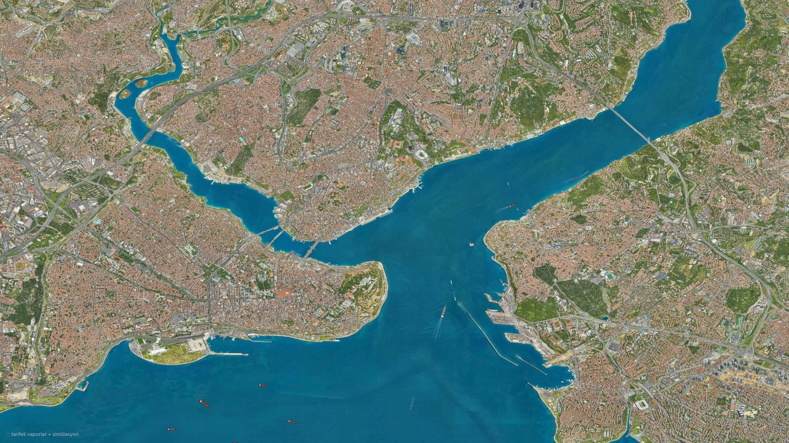
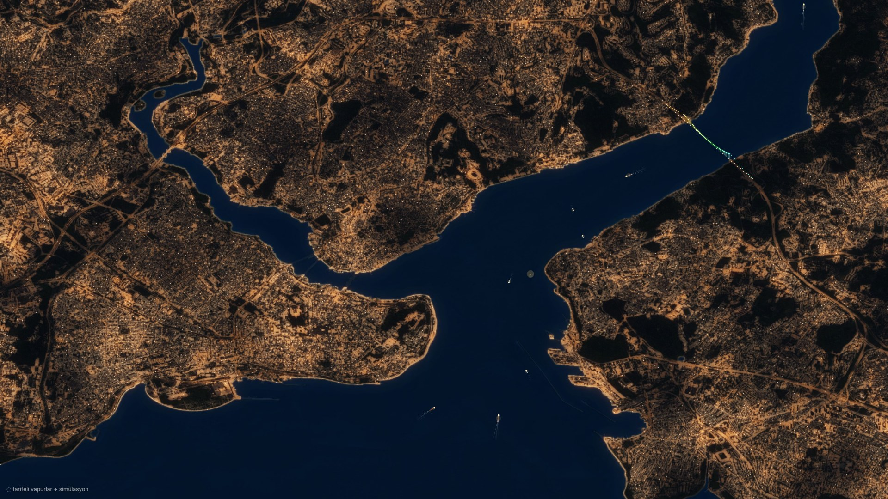
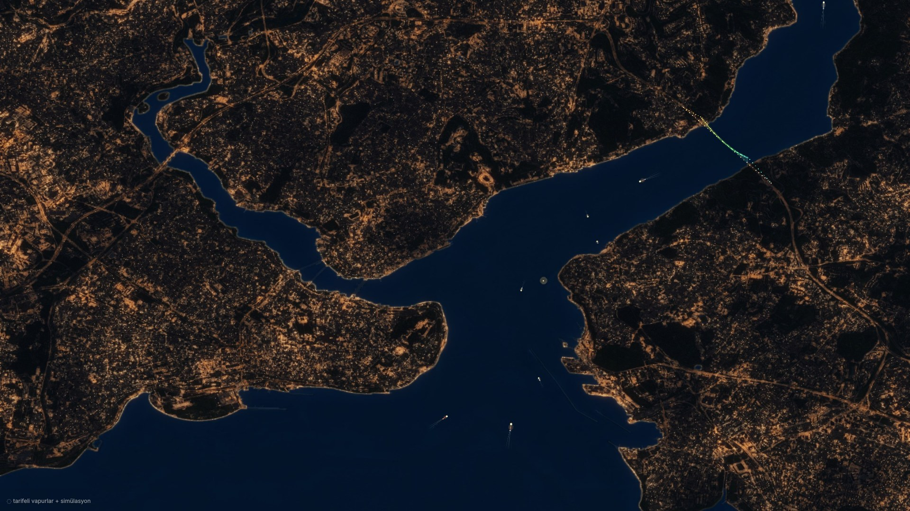

# Boğaz Canlı

İstanbul Boğazı'nı canlı bir KDE Plasma 6 duvar kağıdına çeviren proje. Vapurlar Şehir Hatları
tarifesine göre iskeleden iskeleye gider, gemiler Boğaz'dan geçer. Akşam olunca şehir ışıkları
yanar ve 15 Temmuz Şehitler Köprüsü renk değiştirir. AIS verisi geldiğinde gerçek gemiler gerçek
konumlarıyla çizilir.

| Gündüz | Gece |
|---|---|
|  |  |

| Gece 03:00 |
|---|
|  |

*A live KDE Plasma 6 wallpaper of the Istanbul Bosphorus: scheduled ferries, transiting ships,
night city lights, and real vessels from AIS when coverage is available.*

```
AISStream.io (isteğe bağlı) ──┐
Şehir Hatları tarifesi ───────┼─► service/bogaz_ais.py ──► localhost:8765/ships.json ──► Plasma QML duvar kağıdı
Gemi trafiği simülasyonu ─────┘     (systemd user servisi)
```

## Özellikler

- **Tarifeli vapurlar (Şehir Hatları 2026-27 kış tarifesi, 18 iskele):**
  - Karşıyaka hatları: Kadıköy–Karaköy–Eminönü, Üsküdar–(Karaköy)–Eminönü, Kadıköy–Beşiktaş
    (Cuma/Cumartesi gece seferleri dahil), Üsküdar–Beşiktaş (Dentur, ~15 dk, yaklaşık)
  - Haliç: Üsküdar–Eyüp, Beşiktaş–Eyüp, Kadıköy–Eyüp (Kasımpaşa, Fener, Balat, Hasköy,
    Ayvansaray, Sütlüce iskeleleriyle)
  - Boğaz: Boğaz hattı, Eminönü–Rumeli Kavağı, Ortaköy–Beşiktaş–Eminönü, Uzun ve Kısa Boğaz
    Turu, Kadıköy–Sarıyer, Bostancı–Karaköy–Kabataş. Görüntünün dışındaki iskelelere giden
    vapurlar köprünün kuzeyinden (ya da Moda açığından) çıkar ve oradan girer.
  - Hafta içi, Cumartesi ve Pazar farkları işlenmiştir; vapur kalkıştan 6 dk önce iskeleye
    yanaşır, ara iskelelerde kısa durur.
- **Gemi trafiği:** Transit gemiler Boğaz'ın trafik düzenine göre iki yönde geçer.
- **Canlı AIS (karma mod):** [AISStream.io](https://aisstream.io) ile görüntü alanına giren gerçek
  gemiler çizilir. Gerçek veri yeterli olduğunda simülasyon kendiliğinden çekilir.
- **Gece görünümü:** Gündüz görselindeki sokak dokusundan üretilmiş şehir ışıkları. Köprüde LED
  aydınlatma, gemilerde seyir fenerleri.
- **Gerçek gün döngüsü:** Gece, güneşin İstanbul'daki gerçek yüksekliğine göre gelir; gün batımından
  sivil alacakaranlığın sonuna kadar yumuşak bir geçiş olur, yıl boyunca kendiliğinden kayar.
  Bina ışıkları 23:00'ten sonra sönmeye başlar, 03:00'te en azdır (sokak lambaları yanık kalır),
  sabah yeniden artar. Cuma ve Cumartesi geceleri şehir bir saat geç yatar.
- **Hafif:** Chromium kullanmaz; Plasma'nın kendi QML motorunda varsayılan 10 FPS ile çalışır.
  Servis yalnızca Python standart kütüphanesini kullanır; canlı mod için `websockets` gerekir.

## Gereksinimler

- KDE Plasma 6 (Fedora KDE 41+ üzerinde geliştirildi)
- Python 3.9+
- Görseli hazırlamak için bir kez: `pip install --user opencv-python numpy`
- Canlı AIS için (isteğe bağlı): `sudo dnf install python3-websockets` ve ücretsiz bir AISStream API anahtarı

## Kurulum

### 1. Görsel (hazır)

Gemileri silinmiş gündüz görseli ve gece görseli depoda hazır geliyor
(`plasmoid/contents/images/`). Kendi ekran görüntünden yeniden üretmek istersen:

```bash
pip install --user opencv-python numpy
python3 tools/prepare_images.py ekran_goruntusu.png   # 2160×1440, aynı kadraj
```

> Gemi konumlarını görsele oturtan dönüşüm (`plasmoid/contents/ui/geo.js` içindeki `H` matrisi) ve
> köprü koordinatları bu görsele göre ölçüldü. Farklı bir kadraj kullanırsan homografiyi 4–6 kontrol
> noktasıyla (köprüler, Kız Kulesi, stadyumlar) yeniden hesaplamak gerekir (`cv2.findHomography`).

### 2. Kur

```bash
./install.sh
```

Betik şunları yapar:
- Servisi `~/.local/share/bogaz-canli/` klasörüne kurar ve systemd user servisi olarak başlatır.
- Plasma eklentisini kurar.
- Tüm masaüstlerinde duvar kağıdı olarak ayarlar. Bunu istemiyorsan `--no-set` ile çalıştır.

Değişiklik görünmezse: `systemctl --user restart plasma-plasmashell`

### 3. Canlı AIS (isteğe bağlı)

1. https://aisstream.io adresinde GitHub hesabınla giriş yap ve bir API anahtarı oluştur.
2. `~/.config/bogaz-canli/config.json` dosyasına yaz:
   ```json
   { "api_key": "ANAHTARIN", "mode": "auto" }
   ```
3. `systemctl --user restart bogaz-canli`

| `mode` | Davranış |
|---|---|
| `auto` (varsayılan) | Gerçek gemiler + gerektiğinde tarifeli vapurlar ve simülasyon |
| `live` | Yalnızca gerçek AIS verisi |
| `sim` | Yalnızca tarife ve simülasyon |

> AISStream gönüllü alıcılarla çalışır. Kasım 2026 itibarıyla Boğaz'ı gören bir alıcısı yok;
> yalnızca Avcılar–Küçükçekmece açıklarını görüyor. O yüzden bugün karma mod ağırlıklı olarak tarife
> ve simülasyonla çalışır. Sol alttaki durum yazısı Marmara'dan kaç canlı gemi alındığını gösterir.
> Boğaz'ı gören bir alıcı ağa katılırsa gerçek gemiler kendiliğinden haritaya gelir.

## Ayarlar

Masaüstüne sağ tıkla → *Masaüstü ve Duvar Kağıdını Yapılandır* → **Boğaz Canlı**:
kare hızı, gemi boyutu, gece görünümü, durum yazısı.

## Sorun giderme

```bash
journalctl --user -u bogaz-canli -f                 # servis günlüğü
curl -s localhost:8765/ships.json | head -c 600     # servisin verdiği veri
```

Log'da sürekli `baglanti koptu` ve `API anahtari gecersiz olabilir` görüyorsan API anahtarını kontrol et.

Kaldırmak için: `./uninstall.sh`

## Dosyalar

| Yol | İçerik |
|---|---|
| `plasmoid/contents/ui/Scene.qml` | Sahne: arka plan, gece geçişi, servis sorgusu, durum yazısı |
| `plasmoid/contents/ui/Ship.qml` | Gemi: hıza ve rotaya göre ileri tahmin, dümen suyu, seyir fenerleri |
| `plasmoid/contents/ui/Bridge.qml` | 15 Temmuz Köprüsü LED aydınlatması |
| `plasmoid/contents/ui/geo.js` | Enlem/boylam → görsel pikseli homografisi |
| `service/bogaz_ais.py` | AIS istemcisi, vapur tarifesi (`TIMETABLE`), simülasyon, HTTP sunucusu |
| `tools/prepare_images.py` | Gemi silme ve gece görseli üretimi |

## Tarifeyi güncellemek

Saatler `service/bogaz_ais.py` içindeki `TIMETABLE` listesinde. Her hat için gün tipi (`all`,
`wd` = hafta içi, `ms` = Pazartesi–Cumartesi, `fs` = Cuma/Cumartesi gecesi), kalkış saatleri ve
sefer süreleri tanımlı. Yaz tarifesi Haziran 2027'de başlıyor.

## Teşekkürler ve kaynaklar

- Arka plan: **Isometric Istanbul** (Yahya Bedirhan Pak), İBB 3B şehir modelinden yapay zekâyla
  üretilmiş, ücretsiz ve ticari olmayan izometrik harita. Depodaki görseller bu haritanın ekran
  görüntüsünden türetilmiştir.
- Vapur saatleri: Şehir Hatları 2026-27 kış tarifesi (aktarım:
  [e-yasamrehberi.com](https://www.e-yasamrehberi.com/deniz_ulasimi/sehir-hatlari-kadikoy-karakoy-eminonu-vapur-saatleri.html)).
  Resmî kaynak: [sehirhatlari.istanbul](https://sehirhatlari.istanbul).
- Canlı veri: [AISStream.io](https://aisstream.io)

## Lisans

Kod [MIT](LICENSE) lisanslıdır. `plasmoid/contents/images/bosphorus*.jpg` ve `docs/` altındaki
görseller Isometric Istanbul'dan türetilmiştir ve MIT lisansının kapsamında değildir; haklar
sahiplerine aittir. Ticari olmayan amaçla paylaşılmıştır. Hak sahibinin talebi hâlinde kaldırılır.
